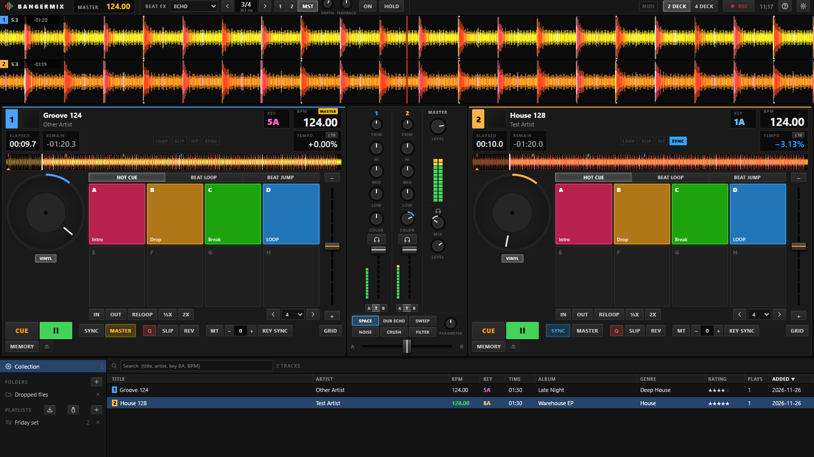
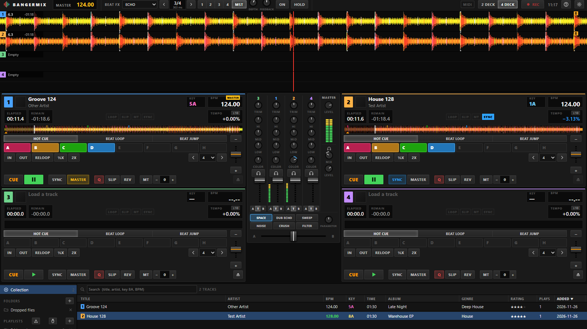
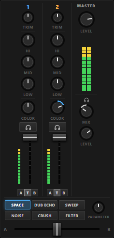
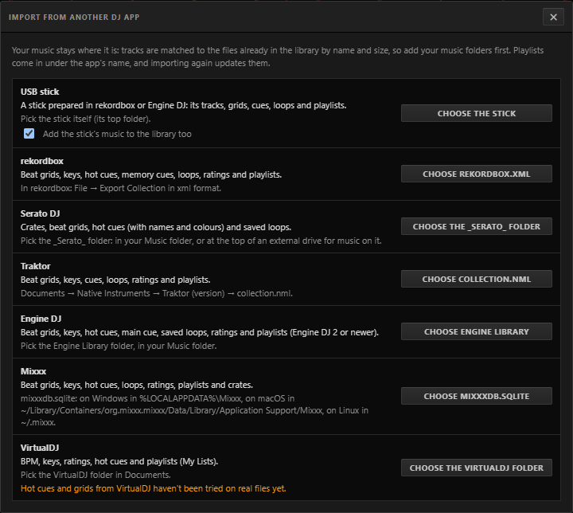
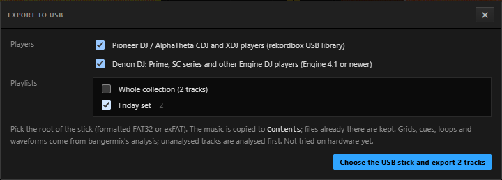

<p align="center">
  
</p>

<h1 align="center">BangerMix</h1>

<p align="center">
  A DJ app that runs in your browser or on your desktop.<br />
  Two or four decks, a club-style mixer with effects, controllers, library import from<br />
  rekordbox, Serato, Traktor and more, and USB export for CDJs and Denon players.
</p>

<p align="center">
  <a href="https://bangermix.horly.dev"><b>Open in the browser</b></a> ·
  <a href="https://github.com/horlesq/bangermix/releases"><b>Download the desktop app</b></a>
</p>



Everything runs on your computer: the audio engine, track analysis and your library. Nothing is uploaded.

> **Beta: help test it.** BangerMix hasn't been tried on real DJ hardware yet. If you have a controller, a CDJ/XDJ or a Denon player, please try it and tell me how it went, even if everything worked: [controller report](https://github.com/horlesq/bangermix/issues/new?template=controller.yml) · [USB stick on a player](https://github.com/horlesq/bangermix/issues/new?template=player.yml) · [bug report](https://github.com/horlesq/bangermix/issues/new?template=bug.yml).

## Contents
- [Features](#features)
- [Getting started](#getting-started)
- [Using BangerMix](#using-bangermix)
- [The mixer and its effects](#the-mixer-and-its-effects)
- [Bringing your library from another app](#bringing-your-library-from-another-app)
- [Controllers](#controllers)
- [USB export for CDJs and Denon players](#usb-export-for-cdjs-and-denon-players)
- [Development](#development)
- [How it works](#how-it-works)
- [Credits and licences](#credits-and-licences)

## Features
| | |
|---|---|
| **Decks** | 2 or 4 decks, scrolling 3-band waveforms, beat sync, keylock and key shift, loops, beat jump, slip, reverse, 8 hot cues with names and colours |
| **Mixer** | Laid out like a Pioneer DJM-900NXS2: trim, 3-band EQ, 6 Sound Color FX, 14 Beat FX, crossfader, headphone cue on a second output or a split cable |
| **Library** | Your music folders, playlists, BPM and key analysis with beat grids, search by title, artist, key or BPM |
| **Import** | Grids, cues, loops, keys, ratings and playlists from rekordbox (XML or a USB stick), Serato DJ, Traktor, Engine DJ, Mixxx and VirtualDJ |
| **Controllers** | About 50 Pioneer, Traktor, Numark and Denon controllers through the Mixxx project's mappings, plus MIDI learn for anything else |
| **USB export** | A stick that CDJ/XDJ and Denon players read like rekordbox's own: grids, cues, loops and waveforms |
| **Everywhere** | Works offline once loaded; a desktop app for Windows, macOS and Linux; mouse and keyboard play without any controller |



## Getting started
**In the browser:** open [bangermix.horly.dev](https://bangermix.horly.dev) in **Chrome or Edge**. Other browsers play music too, but they can't use controllers, remember your music folder or pick the audio output.

**Desktop app:** download it from [Releases](https://github.com/horlesq/bangermix/releases) (Windows installer, macOS disk image, Linux AppImage). It works like Chrome without the permission prompts: controllers, folders and audio outputs just work, and it keeps playing in the background. The builds aren't code-signed yet, so the first start warns you:
- **Windows:** *More info → Run anyway*.
- **macOS:** right-click the app → *Open*.

Then:
1. **Add your music.** Press *Add music folder*, or drop files and folders onto the window. Tracks are analysed in the background: BPM, beat grid, key and waveform.
2. **Load a track.** Double-click it, or drag it onto a deck.
3. **Mix.** Press play, then SYNC on the other deck.

## Using BangerMix
### Library and playlists
- **Folders:** BangerMix remembers your music folders. After a browser restart it may ask for one click (*Reconnect*) before it can read them again.
- **Playlists:** press **+** beside PLAYLISTS. Fill a playlist as you would in rekordbox:
  - drag tracks onto its name; Ctrl-click, Shift-click or `Ctrl A` selects several;
  - right-click a track → *Add to…*;
  - drag a whole folder from the sidebar onto it.

### Playing
- **Pads** have three modes: HOT CUE, BEAT LOOP and BEAT JUMP.
- **Keylock:** MT keeps the pitch when the tempo changes. − / + shifts the key, and KEY SYNC matches the master deck's key.
- **Mouse:** drag knobs and faders. Double-click resets them, and Shift gives fine moves. Drag a waveform or jog wheel to scratch, or to nudge with *Vinyl* off. Scroll a waveform to zoom.
- **Headphones:** Settings → Audio. A controller with a 4-output sound card puts the headphones on outputs 3–4. You can also pick a separate device, or *split* one stereo output: master on the left, headphones on the right.
- **Recording:** ● REC records the master output and saves a `.webm` file when you stop.

### Keyboard
Press `F1` in the app for the full list.

| | Deck 1 (left hand) | Deck 2 (right hand) |
|---|---|---|
| Load the selected track | `E` | `I` |
| Cue / play | `Z` / `X` | `M` / `,` |
| Sync | `C` | `.` |
| Keylock | `D` | `J` |
| Hot cues | `1`–`4` | `7`–`0` |

`↑` `↓` move through the track list, and `Ctrl F` searches. In the desktop app, `F11` toggles full screen and `Ctrl +` / `Ctrl −` / `Ctrl 0` zoom the interface.

## The mixer and its effects


The mixer follows the Pioneer DJM-900NXS2 found in most clubs, so what you learn here carries over to the real one.

**Sound Color FX.** Pick one of the six buttons along the bottom. Each channel's FX knob then applies it to that channel: off in the centre, a different flavour either side. PARAMETER adjusts it.

| Effect | Left | Right | PARAMETER |
|---|---|---|---|
| **SPACE** | Reverb on the lows | Reverb on the highs | Size |
| **DUB ECHO** | Echo, repeats darkening | Echo, repeats thinning | Feedback |
| **SWEEP** | Gate: tighter sound | Band-pass sweep | Gate hardness or band width |
| **NOISE** | White noise, filter closing | White noise, filter opening | Noise colour |
| **CRUSH** | Bit crusher | Crushed and high-passed | Amount |
| **FILTER** | Low-pass | High-pass | Resonance |

**Beat FX.** In the top bar. Choose the effect, the length in beats (1/16 to 16, synced to the master tempo), and the channel (1–4 or M for the master). Then set LEVEL/DEPTH and press ON, or hold HOLD. The effects are DELAY, ECHO, PING PONG, SPIRAL, REVERB, TRANS, FILTER, FLANGER, PHASER, PITCH, SLIP ROLL, ROLL, VINYL BRAKE and HELIX. The echoes and the reverb ring out after you switch them off, as they do on the DJM.

## Bringing your library from another app


The import button beside PLAYLISTS (also in Settings → Library) brings another app's work across: grids, cues, saved loops, keys, ratings and playlists. Add your music folders first: tracks are matched to the files already in the library by name and size, and the folders they're in break any ties. Imported playlists appear under the app's name (*Serato / House*), and importing again updates them.

| From | Pick | Comes across |
|---|---|---|
| **rekordbox** | `rekordbox.xml` (File → Export Collection in xml format) | Grids, keys, hot and memory cues, loops, ratings, playlists |
| **USB stick** | The stick, prepared in rekordbox or Engine DJ | The same, and optionally the stick's music itself |
| **Serato DJ** | The `_Serato_` folder (in Music, or at the top of a drive) | Crates, grids, hot cues with names and colours, saved loops |
| **Traktor** | `collection.nml` (Documents → Native Instruments → Traktor) | Grids, keys, cues, loops, ratings, playlists |
| **Engine DJ** | The `Engine Library` folder (Engine DJ 2 or newer) | Grids, keys, hot cues, main cue, loops, ratings, playlists |
| **Mixxx** | `mixxxdb.sqlite` | Grids, keys, hot cues, loops, ratings, playlists, crates |
| **VirtualDJ** | The `VirtualDJ` folder in Documents | BPM, keys, ratings, hot cues, playlists (*My Lists*) |

These readers are tested with files written by the apps where real ones were available: Serato's own tags from Mixxx's test data, and rekordbox's demo stick. VirtualDJ's hot cues and grids haven't been tried on real files yet.

## Controllers
Settings → Controllers → *Connect MIDI controllers*. BangerMix recognises a controller by its name and loads its mapping; you can choose another mapping in the same place.

- **Pioneer, Traktor, Numark and Denon:** about 50 models, listed under *Supported controllers*. They use mappings from the [Mixxx](https://mixxx.org) project.
- **Traktor Kontrol:** most models are HID devices rather than MIDI. Connect them with *Connect a HID controller*.
- **Anything else:** MIDI learn, one control at a time.

The mappings have been tested with simulated controller messages, not yet with real hardware.

## USB export for CDJs and Denon players


Press the USB button beside PLAYLISTS, tick the playlists and the players, then pick the root of the stick (FAT32 or exFAT).

| Players | What goes on the stick |
|---|---|
| **Pioneer DJ / AlphaTheta** CDJ and XDJ | A rekordbox device library in `PIONEER/`: beat grids, hot cues with colours and names, memory cues, loops, and waveforms for every player generation up to the CDJ-3000 |
| **Denon DJ** Prime and SC series (Engine 4.1 or newer) | An Engine DJ library in `Engine Library/` with the same grids, cues, loops and waveforms |

- **One stick for both:** the music is copied once into `Contents/`, so one stick can serve both kinds of player.
- **Exporting again** only copies new files.
- **Not supported yet:** the OPUS-QUAD and OMNIS-DUO need rekordbox's newer *Device Library Plus*, which isn't written yet.
- **Not tried on hardware yet.** The exports are checked against open-source readers of both formats.

## Development
You need Rust (stable, with `rustup target add wasm32-unknown-unknown`) and Node.js 22 or newer. On Windows, use PowerShell. From the repository root:

```sh
npm install            # packages for the web app (web/) and the desktop app (desktop/)
npm run dev            # builds the WebAssembly, then serves http://localhost:5173
npm run build          # production build in web/dist
npm run preview        # serves the build
npm test               # Rust tests (cargo test --workspace)
npm --prefix web test  # web tests (Vitest): the library importers

npm run desktop        # builds the web app and opens it in the desktop app
npm run desktop:dist   # packages it: desktop/dist/BangerMix-Setup-<version>.exe on Windows
```
`npm --prefix desktop run dev` opens the dev server in the desktop window instead. `Ctrl+Shift+I` opens the developer tools there.

### Releases and deployment
- **Website:** every push to `main` is built by CI and deployed to Cloudflare Pages (bangermix.horly.dev). That needs the repository secrets `CLOUDFLARE_API_TOKEN` and `CLOUDFLARE_ACCOUNT_ID`. Pages must send the headers in `web/public/_headers`, because without them the browser withholds the shared memory the engine uses.
- **Desktop app:** push a tag such as `v0.2.0`. The *Desktop* workflow builds the Windows installer, the macOS disk image (Apple Silicon and Intel) and the Linux AppImage, then publishes them as a GitHub release of that version. *Run workflow* on the Actions page builds them without releasing.

## How it works
The audio engine is written in Rust, compiled to WebAssembly and run on the browser's audio thread. The interface sends it parameter changes and reads its state (positions, meters) from shared memory every frame. Decoding and analysis run in a pool of Web Workers, with one kept free so loading a deck never waits behind library analysis. The desktop app is the same web build in Electron, served from a private `app://` origin.

```
crates/
  bm-dsp          filters, 3-band isolator EQ, DJ filter, limiter, interpolation
  bm-engine       decks, mixer, sync, loops, slip, scratch, keylock (WSOLA), Sound Color
                  FX and beat FX; never allocates while rendering
  bm-analysis     tempo, beat grid, downbeat, key, loudness, waveform data
  bm-decode       MP3/FLAC/WAV/AIFF/M4A/Ogg and tags, via Symphonia
  bm-engine-wasm  the engine for the AudioWorklet (plain C-ABI exports)
  bm-worker-wasm  decoding, analysis and exports for the Web Workers
  bm-export       USB export, and reading USB sticks: the rekordbox device library
                  (export.pdb, ANLZ files)
third_party/
  rekordcrate     Pioneer device-library reader/writer, vendored (see its PATCHES.md)
desktop/
  main.mjs        the Electron app: serves web/dist, grants device permissions
web/
  public/worklet.js   runs engine.wasm on the audio thread
  src/audio           the engine's main-thread side, the recorder
  src/workers         decoder/analyser worker pool
  src/state           decks, mixer, library (IndexedDB), settings
  src/ui              Solid components; waveforms and meters are canvases
  src/midi            Web MIDI and WebHID, MIDI learn
  src/midi/mixxx      runs Mixxx controller mappings: their XML, scripts and controls
  src/export          USB export: copying, the Engine DJ database (SQLite)
  src/import          library import: rekordbox, Serato, Traktor, Engine DJ, Mixxx, VirtualDJ
```

**Controller mappings.** Mixxx keeps open mappings for hundreds of controllers: an XML file of MIDI messages and a script for jogs, LEDs and shift layers. The first time a controller is used, BangerMix fetches its files from Mixxx's GitHub repository (release 2.5.6) and caches them, so it then works offline. The scripts run in a hidden iframe with the same `engine`, `midi` and `controller` objects Mixxx gives them. Mixxx's controls (`[Channel1] play`, `[Master] crossfader`, …) map onto BangerMix's decks, mixer, effects and browser. Controls with no counterpart here, such as samplers and stems, are accepted and do nothing.

**USB formats.**
- **Pioneer:** `export.pdb` is written by rekordcrate, following rekordbox's table layout. The analysis files (`ANLZ0000.DAT`, `.EXT`, `.2EX`) are written section by section as rekordbox writes them, from [Deep Symmetry's format analysis](https://djl-analysis.deepsymmetry.org/rekordbox-export-analysis/anlz.html). Phrase analysis isn't written yet.
- **Denon:** Engine DJ schema 3.0.0 is built in the browser with SQLite. The row values and blob encodings follow libdjinterop, the library Mixxx uses for its own Engine exports.

## Credits and licences
- [Mixxx](https://mixxx.org): the controller mappings (GPL-2.0-or-later). They are downloaded when a controller is used and aren't part of this repository.
- [rekordcrate](https://github.com/Holzhaus/rekordcrate): the `export.pdb` writer (MPL-2.0), vendored in `third_party/` with one small addition described in its `PATCHES.md`.
- [libdjinterop](https://github.com/xsco/libdjinterop): the Engine DJ schema in `web/src/export/engine-schema-3.0.0.sql` (LGPL-3.0).
- [Deep Symmetry](https://djl-analysis.deepsymmetry.org): the documentation of rekordbox's analysis files.
- [serato-tags](https://github.com/Holzhaus/serato-tags) by Jan Holthuis, and Mixxx's own library readers: the documentation of Serato's database, crates and tags, and of Traktor's and Mixxx's libraries.
- [Symphonia](https://github.com/pdeljanov/Symphonia) for decoding, [Solid](https://www.solidjs.com) for the interface, [sql.js](https://github.com/sql-js/sql.js) for SQLite, [Electron](https://www.electronjs.org) for the desktop app.
